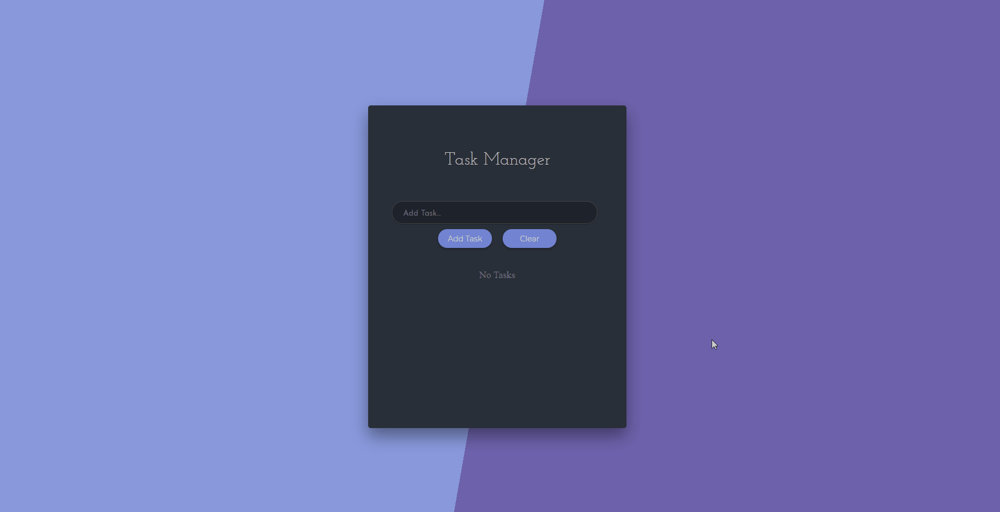

<h1 align="center">📝 Task Manager</h1>

<p align="center">
  A simple and fast task manager built with React 19 and Vite.
</p>

<p align="center">
  
  
  
</p>

<p align="center">
  
</p>

## 📖 About

**Task Manager** is a minimal to-do app: add a task, rename it, remove it, or wipe
the whole list. Everything is saved to your browser's `localStorage`, so the list
is still there the next time you open the page — no account, no backend, no setup.

It was built as a study project to practice **React hooks** and the **Context API**
without a state management library. All the state lives in a single context
provider, and the components below it just read from it. The whole app is about
200 lines of code, which makes it a good reference for anyone learning how
`useState`, `useEffect` and `useContext` fit together in a real feature.

## ✨ Features

- ➕ Add a task
- ✏️ Edit an existing task
- 🗑️ Remove a single task
- 🧹 Clear the whole list
- 💾 Tasks persisted in `localStorage`
- ⌨️ Keyboard accessible, with visible focus states

## 🛠️ Tech stack

- ⚛️ [React 19](https://react.dev/) — hooks and the Context API
- ⚡ [Vite 8](https://vite.dev/) — dev server and production build
- 🎨 Plain CSS — no UI framework
- 🔣 [Font Awesome](https://fontawesome.com/) — icons

## 🚀 Getting started

Requires **Node.js 20.19+** (or 22.12+).

```bash
git clone https://github.com/Felps03/react-Task-Manager.git
cd react-Task-Manager
npm install
npm run dev
```

The dev server prints a local URL (`http://localhost:5173` by default).

## 📜 Scripts

| Command           | Description                                     |
| ----------------- | ----------------------------------------------- |
| `npm run dev`     | Start the dev server with hot module replacement |
| `npm run build`   | Build for production into `dist/`                |
| `npm run preview` | Serve the production build locally               |

## 📂 Project structure

```
index.html                       # Vite entry point
vite.config.js
public/                          # Static assets copied as-is
src/
  main.jsx                       # Mounts <App /> into #root
  App.css                        # All the styling
  components/
    App.jsx                      # Layout, wraps everything in the provider
    Header.jsx
    TaskForm.jsx                 # Add / edit form
    TaskList.jsx                 # Renders the list or the empty state
    Task.jsx                     # A single row with its delete/edit buttons
  contexts/
    TaskListContext.jsx          # Task state, actions and localStorage sync
```

## ⚙️ How it works

All state lives in `TaskListContext.jsx`. It holds two pieces of state:

- **`tasks`** — the list, hydrated from `localStorage` on first render and written
  back by an effect whenever it changes.
- **`editItem`** — the task currently being edited, or `null` when the form is in
  "add" mode.

`TaskForm` reads `editItem` to decide whether submitting should call `addTask`
or `editTask`, and mirrors its title into the input. Every action that could
make `editItem` stale (clearing the list, deleting the task being edited) resets
it back to `null`.

IDs come from the browser's built-in [`crypto.randomUUID()`](https://developer.mozilla.org/en-US/docs/Web/API/Crypto/randomUUID),
which is available on `localhost` and any HTTPS origin.

## 🏷️ Topics

`#react` `#react19` `#vite` `#javascript` `#hooks` `#context-api`
`#todo-app` `#task-manager` `#localstorage` `#frontend` `#spa`

## 📄 License

Released under the MIT License.

---

<p align="center">
  Made with ☕ by <a href="https://github.com/Felps03">Felps03</a>
</p>
